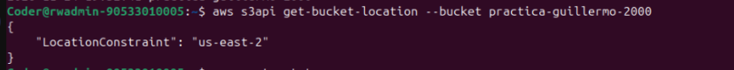
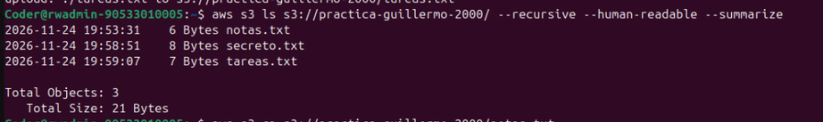
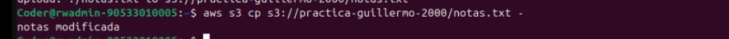
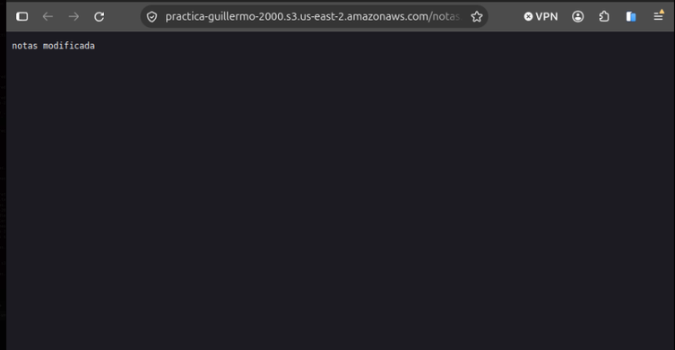
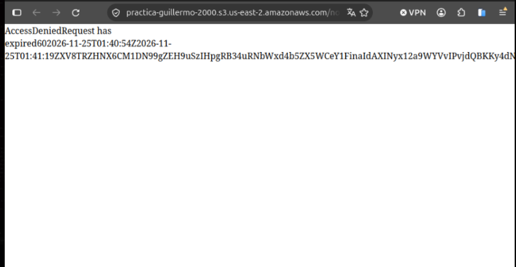
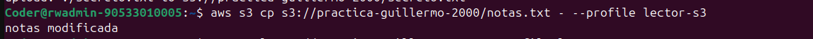
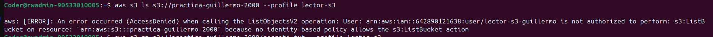
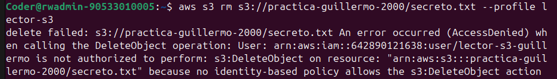
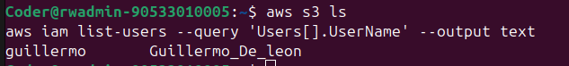

# Evidencia: ciclo de vida de un bucket en S3

**Autor:** Guillermo De Leon Rojano
**Bucket:** `practica-guillermo-2000`
**Región:** `us-east-2`
**Usuario lector:** `lector-s3-guillermo` (perfil `lector-s3`)

> Las claves de acceso nunca se imprimieron ni se incluyen en este documento.

---

## Parte 1: Crear

### Paso 3: región del bucket

```bash
aws s3api get-bucket-location --bucket practica-guillermo-2000
```



El bucket quedó en `us-east-2`, la misma región configurada en la CLI.

---

## Parte 2: Subir

### Paso 7: contenido del bucket con tamaños legibles y total

```bash
aws s3 ls s3://practica-guillermo-2000/ --recursive --human-readable --summarize
```



El bucket tiene tres objetos (`notas.txt`, `secreto.txt` y `tareas.txt`), 21 bytes en total.

---

## Parte 4: Editar

### Paso 13: contenido de `notas.txt` desde el bucket tras modificarlo

```bash
aws s3 cp s3://practica-guillermo-2000/notas.txt -
```



El objeto se sobrescribió con el contenido nuevo. S3 no conservó la versión anterior, porque el bucket no tiene versionado activado.

---

## Parte 5: Compartir sin hacerlo público

### Paso 14: enlace temporal de 60 segundos

```bash
aws s3 presign s3://practica-guillermo-2000/notas.txt --expires-in 60
```

La URL generada se omite aquí porque contiene una firma; el enlace ya expiró.

### Paso 15: el enlace funciona antes de que pase el minuto



### Paso 16: el enlace ya expiró



El navegador devolvió `AccessDenied - Request has expired`. El bucket nunca dejó de ser privado.

---

## Parte 6: Menor privilegio

### Pasos 17 a 20: usuario, política y perfil

```bash
aws iam create-user --user-name lector-s3-guillermo

aws iam put-user-policy --user-name lector-s3-guillermo --policy-name leer-objetos --policy-document file://solo-lectura.json
```

Política en línea `leer-objetos` (`solo-lectura.json`):

```json
{
  "Version": "2012-10-17",
  "Statement": [{
    "Effect": "Allow",
    "Action": ["s3:GetObject"],
    "Resource": "arn:aws:s3:::practica-guillermo-2000/*"
  }]
}
```

Después se creó la llave de acceso y se configuró el perfil `lector-s3` en la región `us-east-2`. La clave secreta no se muestra en ningún momento.

### Paso 21: leer `notas.txt` con el perfil lector (permitido)

```bash
aws s3 cp s3://practica-guillermo-2000/notas.txt - --profile lector-s3
```



### Paso 22: listar el bucket con el perfil lector (denegado)

```bash
aws s3 ls s3://practica-guillermo-2000 --profile lector-s3
```



Falta el permiso `s3:ListBucket`.

### Paso 23: borrar `secreto.txt` con el perfil lector (denegado)

```bash
aws s3 rm s3://practica-guillermo-2000/secreto.txt --profile lector-s3
```



Falta el permiso `s3:DeleteObject`.

---

## Parte 7: Eliminar

### Paso 24: borrar el bucket sin vaciarlo

```bash
aws s3 rb s3://practica-guillermo-2000
```


Salida:

```
remove_bucket failed: s3://practica-guillermo-2000 An error occurred (BucketNotEmpty) when calling the DeleteBucket operation: The bucket you tried to delete is not empty
```

### Pasos 25 a 28

```bash
aws s3 rm s3://practica-guillermo-2000 --recursive
aws s3 rb s3://practica-guillermo-2000
aws iam delete-access-key --user-name lector-s3-guillermo --access-key-id <ID-DE-LA-LLAVE>
aws iam delete-user-policy --user-name lector-s3-guillermo --policy-name leer-objetos
aws iam delete-user --user-name lector-s3-guillermo
```

Salida de los pasos 25 y 26:

```
delete: s3://practica-guillermo-2000/pendientes.txt
delete: s3://practica-guillermo-2000/secreto.txt
delete: s3://practica-guillermo-2000/notas.txt
remove_bucket: practica-guillermo-2000
```

Después se eliminó el bloque `[lector-s3]` de `~/.aws/credentials` y el bloque `[profile lector-s3]` de `~/.aws/config`.

### Paso 29: verificación final

```bash
aws s3 ls
aws iam list-users --query 'Users[].UserName' --output text
```



No queda ningún bucket y el usuario `lector-s3-guillermo` ya no existe. Los dos usuarios que aparecen existían antes de la actividad.

---

## Preguntas de reflexión

**1. ¿Por qué el nombre de tu bucket tuvo que ser distinto al de tus compañeros si cada uno tiene su propia cuenta?**
Porque los nombres de bucket son únicos a nivel global en todo AWS, no por cuenta. El nombre forma parte de la dirección de acceso (`nombre.s3.region.amazonaws.com`), y esa dirección tiene que apuntar a un solo bucket en el mundo.

**2. El usuario del paso 21 pudo leer un archivo, pero en el paso 22 no pudo ver la lista. ¿Qué acción le faltaba en la política?**
Le faltaba `s3:ListBucket`. Esa acción se aplica sobre el bucket (`arn:aws:s3:::practica-guillermo-2000`, sin `/*`). La política solo permitía `s3:GetObject`, por eso el error decía que ninguna política permitía `s3:ListBucket`.

**3. En la política, ¿qué significa el `/*` al final del `Resource`? ¿Qué pasaría si se quitara?**
Significa "todos los objetos dentro del bucket". Si se quitara, el recurso sería el bucket mismo y no sus objetos. Como `s3:GetObject` actúa sobre objetos, la política dejaría de coincidir con cualquier lectura y el usuario recibiría `AccessDenied` también en el paso 21.

**4. ¿En qué se diferencia compartir un archivo con un enlace temporal de hacer público el bucket?**
El enlace temporal da acceso a un solo objeto, durante un tiempo limitado, usando una firma generada con mis credenciales. Al expirar deja de funcionar (como se vio en el paso 16) y el bucket sigue privado. Hacer público el bucket abre el acceso a cualquier persona de internet, sin límite de tiempo y potencialmente sobre todos los objetos, hasta que alguien lo corrija.

**5. Según el modelo de responsabilidad compartida, si alguien deja un bucket público con datos de clientes, ¿de quién es la responsabilidad?**
Del cliente. AWS es responsable de la seguridad *de* la nube (infraestructura, hardware, servicio). El cliente es responsable de la seguridad *en* la nube: configurar permisos, políticas y el acceso público de sus buckets, y proteger sus datos.

---

## Observaciones

- Al inicio subí por error a `s3://practica-s3/` (el nombre de la carpeta local) y obtuve `AccessDenied`, porque ese bucket no es mío. Al usar el nombre correcto, `practica-guillermo-2000`, funcionó.
- El primer `mkdir practica-s3` falló dos veces por falta de espacio en el dispositivo y funcionó al tercer intento.
- Las partes 6 y 7 las repetí paso a paso para tener capturas de cada comando. Para eso recreé el bucket y los archivos antes del paso 21.

---

## Criterios de evaluación

| Criterio | Cumple |
|---|---|
| El bucket fue creado, usado y eliminado en el orden correcto | Sí |
| Se evidencia el enlace temporal funcionando y luego expirado | Sí (pasos 15 y 16) |
| Se evidencia una acción permitida y dos denegadas con el usuario lector | Sí (pasos 21, 22 y 23) |
| La política solo permite `s3:GetObject` sobre su propio bucket | Sí |
| La evidencia no expone ninguna clave secreta | Sí |
| No quedaron buckets, usuarios ni llaves de la actividad en la cuenta | Sí (paso 29) |
